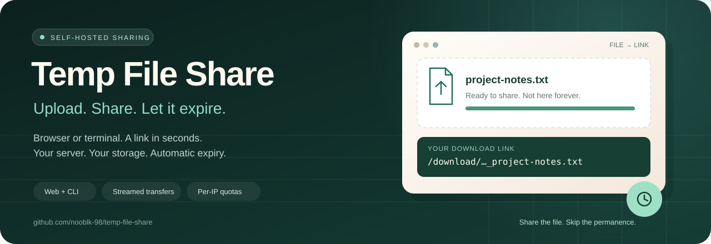
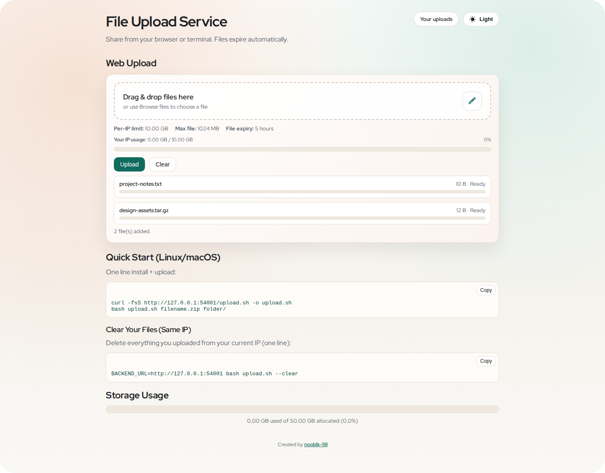
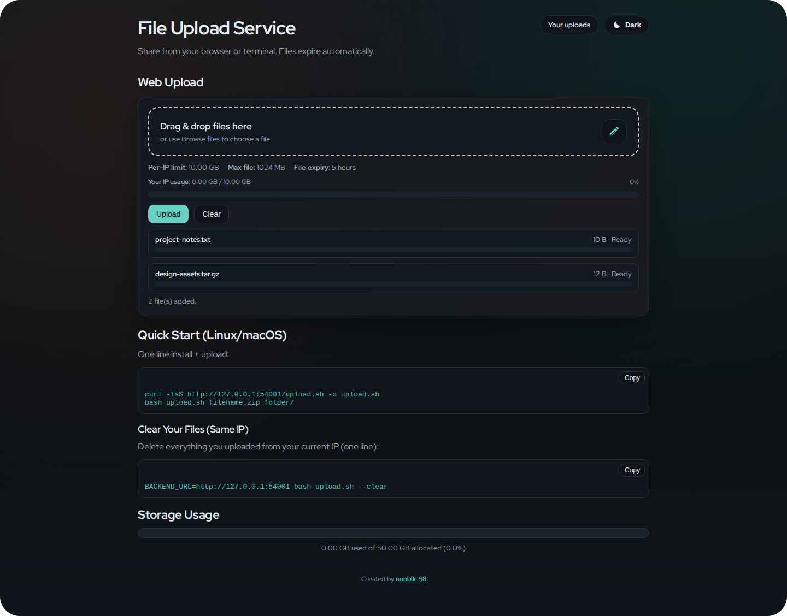
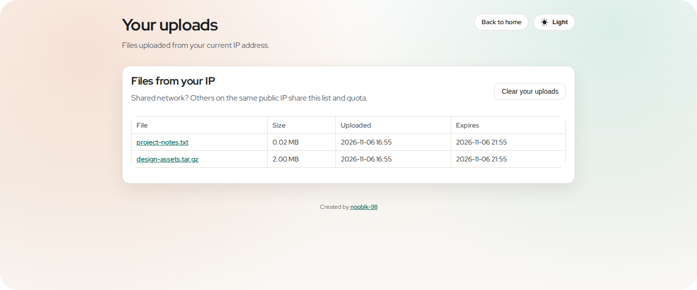
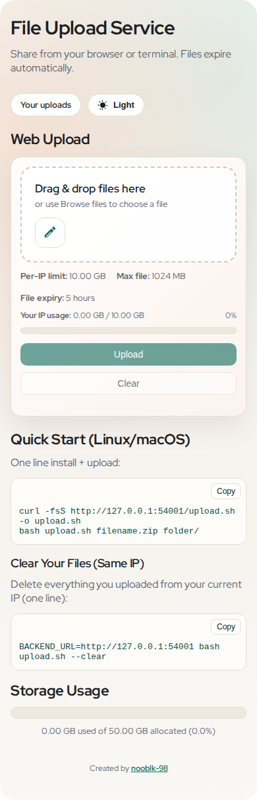

<div align="center">



# Temp File Share

**Self-hosted temporary file sharing, from your browser or terminal.**

[](app/pyproject.toml)
[](https://github.com/nooblk-98/temp-file-share/pkgs/container/temp-file-share)
[](https://github.com/nooblk-98/temp-file-share/actions/workflows/ci.yml)
[](LICENSE)

[Live instance](https://fs.app.itsnooblk.com/) · [Quick start](#quick-start) · [Screenshots](#screenshots) · [Self-host](#self-host) · [Release notes](RELEASE_NOTES.md)

</div>

Upload a file, copy its download link, and let the server clean it up later. Use drag-and-drop in the web UI, or send files and folders with the Bash client. No accounts, database service, or frontend build step.

> **Upgrading?** Read the [release notes](RELEASE_NOTES.md) before deployment. The default Compose stack now pulls the published `live` image; existing upload and metadata directories are preserved.

## At a glance

| Share simply | Stay in control | Run it yourself |
| --- | --- | --- |
| Browser uploads with progress and copyable links | Configurable expiry, total storage, and per-IP quotas | Prebuilt amd64/arm64 container images |
| Bash client archives folders and multiple paths | Per-request size limits and bounded concurrent transfers | Non-root, read-only Docker container |
| Light/dark themes and responsive layouts | Your uploads page shows only your current IP's files | Local JSON metadata; no external database |

## Screenshots

Actual locally rendered application pages, using synthetic files—not design mockups or production user data. Both themes retain the same layout and controls.

### Browser upload · light



<details>
<summary><strong>Dark theme, uploads page, and mobile</strong></summary>

### Browser upload · dark



### Your uploads

Only uploads associated with the visitor's current IP are shown. Filenames link to downloads; public IP/country columns have been removed.



### Mobile · 390 px



</details>

Screenshot provenance and before/after comparisons: [UI review](docs/ui-review/README.md).

## Quick start

### Browser

Open [fs.app.itsnooblk.com](https://fs.app.itsnooblk.com/), choose or drop your files, then select **Upload**. Each successful file gets its own download link. **Your uploads** lists files associated with your current IP.

### Terminal

Download the client, then run it:

```bash
curl -fsS https://fs.app.itsnooblk.com/upload.sh -o upload.sh
bash upload.sh document.pdf
```

```bash
# A folder or multiple paths become one .tar.gz archive
bash upload.sh photos/ notes.txt

# Another server
BACKEND_URL=https://files.example.com bash upload.sh document.pdf

# Delete uploads associated with your current IP
bash upload.sh --clear
```

The client requires Bash, curl, and tar (GNU/Linux or macOS). Upload failures exit nonzero; temporary archives use a unique directory and are cleaned up on exit.

## Self-host

### Deploy the stable image

The main Compose stack runs **`ghcr.io/nooblk-98/temp-file-share:live`**, built from a published stable release. No Git checkout, Python installation, or image build is required on your server.

On a fresh Linux host with Docker Compose, curl, and sudo available, deploy in one command:

```bash
mkdir temp-file-share && cd temp-file-share && curl -fsSL https://raw.githubusercontent.com/nooblk-98/temp-file-share/v2.2.0/docker-compose.yaml -o docker-compose.yaml && printf '%s\n' 'PUBLIC_BASE_URL=http://localhost:34100' > .env && sudo install -d -o 10001 -g 10001 /opt/temp-file-share/uploads /opt/temp-file-share/data && docker compose up -d --pull always
```

Open **http://localhost:34100** on that host. The fresh-install command creates a new working directory and persistent storage, saves the local URL, and starts the published image. It intentionally refuses to overwrite an existing `temp-file-share` directory.

Already have this Compose file and configured storage?

```bash
docker compose up -d --pull always
```

For a public domain, edit `.env` first: set `PUBLIC_BASE_URL`, the intended `HOST_BIND`, and exact `TRUSTED_PROXIES` peers. Default binding is **127.0.0.1:34100**, mapped to container port **54000**. A proxy on another host or over a tunnel needs a reachable private interface—not loopback. Keep backend access restricted to that proxy.

The container uses uid/gid `10001:10001`, a read-only root filesystem, dropped capabilities, no-new-privileges, resource limits, and rotated logs. Existing root-owned storage needs the [non-root migration](docs/MIGRATION-nonroot.md).

### Update or pin a release

The `live` and `latest` tags move only after a stable release passes checks and its multi-platform image passes the container smoke test. To pin a release instead, put `IMAGE_TAG=2.2.0` in `.env`; a manifest digest can be used for a content-addressed pin.

```bash
docker compose up -d --pull always
```

See [deployment options](docs/deployment.md) for alternative stacks, source builds, rollback, and image verification.

### Configuration

Environment variables override `app/config.json`. Compose reads the variables in [.env.example](.env.example). Sizes use binary units: GB = GiB, MB = MiB.

| Setting | Shipped default | Purpose |
| --- | --- | --- |
| `IMAGE_REPOSITORY` | `ghcr.io/nooblk-98/temp-file-share` | Published container repository |
| `IMAGE_TAG` | `live` | Stable release channel, or a pinned version such as `2.2.0` |
| `PUBLIC_BASE_URL` | `https://fs.app.itsnooblk.com` | Public origin used for links and the served upload client; change for your host |
| `UPLOAD_DIR` | `uploads` | Stored files; relative to `app/` |
| `FILES_DB` | `data/files_db.json` | JSON metadata; relative to `app/` |
| `MAX_STORAGE_GB` | `50` | Total disk quota |
| `IP_LIMIT_GB` | `10` | Quota shared by one client IP |
| `MAX_UPLOAD_MB` | `1024` | Maximum file size per request |
| `MAX_AGE_HOURS` | `5` | Download lifetime |
| `RATE_LIMIT_SECONDS` | `2` | Upload-start cooldown per IP; `0` disables it |
| `CLEANUP_INTERVAL_SECONDS` | `300` | Background expiry cleanup interval |
| `TRUSTED_PROXIES` | empty | Comma-separated proxy peer IPs/CIDRs; empty ignores forwarded headers |
| `REQUEST_TIMEOUT_SECONDS` | `30` | Socket inactivity timeout—not total transfer duration |
| `MAX_CONNECTIONS` | `16` | Concurrent handler limit; excess requests receive 503 |
| `PORT` | `54000` | Source server port; keep 54000 inside the provided container |

Compose-specific defaults: `HOST_BIND=127.0.0.1`, `HOST_PORT=34100`, `MEM_LIMIT=512m`, `CPU_LIMIT=1.0`, `PIDS_LIMIT=256`, and `TZ=Asia/Colombo`.

Transfers use 64 KiB chunks rather than buffering entire files in RAM. Temporary uploads live on the uploads filesystem and count against reserved quota before the request body is read. Multipart requests reserve their complete body size, so leave a little quota headroom for headers and boundaries (up to 64 KiB). Keep sufficient disk space and tune concurrency for your host.

### Reverse proxy example

For nginx running on the same host as Compose:

```nginx
location / {
    proxy_pass http://127.0.0.1:34100;
    proxy_set_header Host $host;
    proxy_set_header X-Real-IP $remote_addr;
    proxy_set_header X-Forwarded-For $remote_addr;
    proxy_set_header X-Forwarded-Proto $scheme;
    client_max_body_size 1025m; # 1024 MiB file plus multipart overhead
    proxy_request_buffering off;
    proxy_buffering off;
    proxy_read_timeout 300s;
}
```

Set `PUBLIC_BASE_URL` to your HTTPS origin. Set `TRUSTED_PROXIES` to the exact peer address the application sees for nginx—Docker may present a bridge gateway, not `127.0.0.1`. The proxy must **overwrite** incoming forwarding headers. Do not trust `0.0.0.0/0` or expose the backend directly when proxy trust is enabled.


## API

| Method | Route | Result |
| --- | --- | --- |
| `POST` | `/upload` | One multipart `file` or raw body; plain-text response, first line is the download URL |
| `GET` | `/download/<stored-name>` | Attachment download while the recorded file is unexpired |
| `GET` | `/uploads` | HTML listing scoped to the visitor's current IP |
| `POST` | `/clear` | Deletes uploads associated with the visitor's current IP |
| `GET` | `/upload.sh` | Client script configured for this server |
| `GET` | `/robots.txt` | Lightweight container healthcheck target |

```bash
# Multipart upload, preserving the original filename
curl -fsS -F 'file=@photo.jpg' https://files.example.com/upload

# Raw upload, stored with a generated .bin filename
curl -fsS -H 'Content-Type: application/octet-stream' \
  --data-binary @photo.jpg https://files.example.com/upload
```

Uploads require `Content-Length`; chunked request bodies are not supported. Common responses: **400** malformed upload, **411** missing length, **413** size/quota exceeded, **429** cooldown (`Retry-After` supplied), and **503** all connection slots busy. The browser retries cooldown responses up to three times and keeps failed uploads visibly marked.

## Privacy and operating model

- **No accounts or passwords:** links are bearer links. Anyone given a link can download its file until expiry; files are not end-to-end encrypted.
- **IP-scoped, not user-authenticated:** people sharing a NAT/VPN/public IP share the uploads list, quota, and clear operation. Changing IP changes the visible list. Use a private deployment when that model is unsuitable.
- **No public upload directory:** paths must remain inside storage and refer to a recorded, unexpired file. The uploads UI no longer publishes IP addresses or performs external IP geolocation.
- **Expiry:** downloads stop at expiry; physical deletion happens on the next cleanup pass. Maintain backups according to your retention needs.
- **One server process per storage directory:** a process-local lock and atomic JSON replacement protect concurrent requests and cleanup. Do not point multiple replicas at the same JSON database. Stop the server before backing up or restoring both persistent directories together. Corrupt metadata fails closed; restore a known-good copy rather than resetting it.
- HTTP access logs and the metadata file still contain IPs for operations/quota ownership. The UI loads Google Fonts; self-host fonts if your deployment must avoid that external request.

## Verification

The release is checked on Python 3.11–3.14, with browser workflows and hardened Docker upload/download smoke tests. See [testing instructions](docs/testing.md) for details.

```text
app/                   HTTP service, storage, streaming parser, UI, Bash client
tests/                 Backend regression tests and Playwright browser checks
docs/ui-review/        Real screenshots, provenance, before/after evidence
.github/workflows/     CI and deployment automation
docker-compose.yaml    Stable published-image deployment
docs/                  Deployment options, image automation, and testing
RELEASE_NOTES.md        Release changes and migration guidance
```

## Contributions welcome

Contributions are welcome: bug reports, documentation fixes, accessibility improvements, performance work, and new tests all help make file sharing better.

Read [CONTRIBUTING.md](CONTRIBUTING.md) to set up the project, run checks, and send a focused pull request. Please include clear reproduction steps for bugs and screenshots for UI changes. For security issues, use GitHub's private vulnerability reporting when available instead of posting sensitive details publicly.

## License

[GNU Affero General Public License v3.0](LICENSE).
