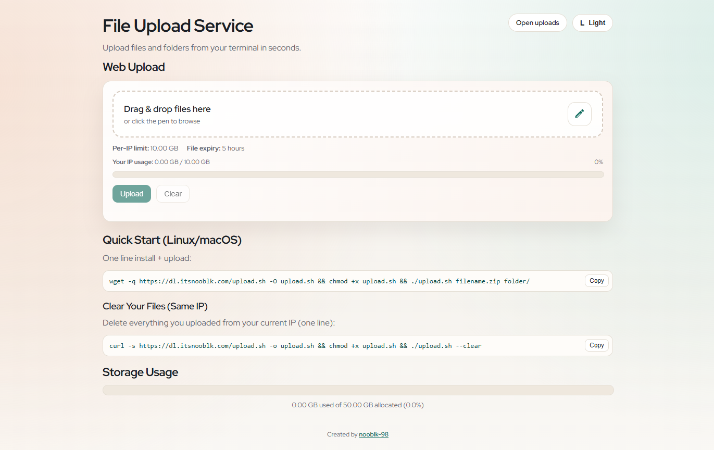

<div align="center">
  

# Temp File Share

**Upload files and folders from your terminal and get a shareable download link.**

[](https://www.python.org/)
[](https://www.docker.com/)
[](LICENSE)
[](app/requirements.txt)

[Features](#features) • [Quick Start](#quick-start) • [Usage](#usage) • [API](#api) • [Configuration](#configuration) • [Deployment](#deployment)

<br>

[](images/ui.png)

</div>

A lightweight file sharing server with zero external dependencies. Upload files from your terminal, get a download link, and the files expire automatically. Folders and multiple files are zipped on the client side before upload.

> [!TIP]
> Try it in one command: `curl -s https://dl.itsnooblk.com/upload.sh | bash -s -- <file>`

---

## Features

**Simple sharing workflow**

- Upload files, folders, or multiple items at once with a single command
- Folders are automatically compressed into a tarball before upload
- Each upload returns a download link immediately

**Built-in abuse protection**

- Per-IP storage quotas prevent excessive usage
- Configurable rate limiting between uploads
- Automatic expiry and cleanup of old files on a background schedule

**Observability**

- Web UI shows storage usage, recent uploads, and expiry times
- Country flags are resolved from IP addresses via geo-lookup
- Server logs include upload, download, and clear events

**Operations friendly**

- Proxy-aware: respects `X-Real-IP` and `X-Forwarded-For` headers
- No build step, no package manager, no database setup
- Runs on any system with Python 3.9+

---

## Quick Start

### One-liner upload

```bash
curl -s https://dl.itsnooblk.com/upload.sh | bash -s -- ./document.pdf
```

### Run the server with Docker

```bash
docker run -d \
  -p 54000:54000 \
  -v uploads:/app/uploads \
  -v data:/app/data \
  --restart unless-stopped \
  ghcr.io/nooblk-98/temp-file-share:latest
```

### Run the server from source

```bash
git clone https://github.com/nooblk-98/temp-file-share.git
cd temp-file-share/app
mkdir uploads data
python3 backend.py
```

> [!TIP]
> Edit `app/config.json` before starting the server to set your domain, storage limits, and expiry duration.

> [!NOTE]
> The image runs as non-root `10001:10001`. If you upgrade an existing `docker run` or compose setup, see [docs/MIGRATION-nonroot.md](docs/MIGRATION-nonroot.md).

---

## Usage

### Upload files

The `upload.sh` script detects whether you're uploading a single file, multiple files, or a directory:

```bash
# Single file
./upload.sh document.pdf

# Multiple items
./upload.sh photos/ documents/ notes.txt

# Directory (auto-zipped)
./upload.sh my-project/
```

**Sample output:**

```
Single file detected, uploading directly: document.pdf
Uploading...
https://dl.itsnooblk.com/download/a64c76df94664379815186a6cf9c55e7_document.pdf
Your IP: 80.225.221.245
File size: 0.03 MB
Expires: 2026-01-25 22:37:16
Disk space left: 117.48 GB
Allocated space remaining: 50.00 GB
IP limit remaining: 10.00 GB
```

### Clear your uploads

Remove all files uploaded from your IP address:

```bash
./upload.sh --clear
```

### Use a remote server

Set the `BACKEND_URL` environment variable to point to a remote instance:

```bash
export BACKEND_URL=https://dl.itsnooblk.com
./upload.sh document.pdf
```

> [!NOTE]
> The upload script is served directly by the server at `GET /upload.sh`, so clients can fetch it without cloning the repo.

---

## API

### Upload a file

```bash
POST /upload
```

Accepts `multipart/form-data` (with a `file` field) or raw binary body.

```bash
# Multipart upload
curl -X POST -F "file=@photo.jpg" http://localhost:54000/upload

# Raw binary upload
curl -X POST -H "Content-Type: application/octet-stream" \
  --data-binary @photo.jpg http://localhost:54000/upload
```

**Response:** Plain text with the download URL, your IP, file size, expiry time, and remaining quotas.

### Download a file

```bash
GET /download/<filename>
```

```bash
curl -O http://localhost:54000/download/<filename>
```

### Clear your files

```bash
POST /clear
```

Deletes all files uploaded from your IP address.

```bash
curl -X POST http://localhost:54000/clear
```

### Web UI

| Route | Description |
|---|---|
| `GET /` | Main dashboard — storage usage, quotas, recent uploads |
| `GET /uploads` | Upload listing — file names, sizes, timestamps, country flags |
| `GET /upload.sh` | Download the client upload script |
| `GET /robots.txt` | Robots exclusion rules |
| `GET /sitemap.xml` | XML sitemap |

---

## Configuration

Settings come from `app/config.json`. Environment variables of the same name override it, and the compose file passes them through from `.env`.

```json
{
  "UPLOAD_DIR": "uploads",
  "MAX_STORAGE_GB": 50,
  "MAX_AGE_HOURS": 5,
  "IP_LIMIT_GB": 10,
  "PUBLIC_BASE_URL": "https://dl.itsnooblk.com",
  "FILES_DB": "data/files_db.json",
  "RATE_LIMIT_SECONDS": 2,
  "CLEANUP_INTERVAL_SECONDS": 300
}
```

| Key | Default | Description |
|---|---|---|
| `UPLOAD_DIR` | `uploads` | Directory for stored files |
| `MAX_STORAGE_GB` | `50` | Total storage limit in GB |
| `MAX_AGE_HOURS` | `5` | File expiry in hours |
| `IP_LIMIT_GB` | `10` | Storage limit per IP address |
| `PUBLIC_BASE_URL` | `""` | Public-facing base URL for download links |
| `FILES_DB` | `data/files_db.json` | Path to the file metadata database |
| `RATE_LIMIT_SECONDS` | `0` | Cooldown between uploads (0 = disabled) |
| `CLEANUP_INTERVAL_SECONDS` | `300` | Expired file cleanup interval in seconds |
| `GEO_IP_ENABLED` | `true` | Resolve country flags from IP addresses |

### Docker Compose (`.env`)

Copy `.env.example` to `.env` (git-ignored) and change what you need. Every value in the example is the compose default.

```bash
cp .env.example .env
```

| Variable | Default | Description |
|---|---|---|
| `TAG` | `latest` | Image tag for `docker compose pull/up` |
| `HOST_PORT` | `34100` | Host port mapped to container port `54000` |
| `UPLOADS_HOST_DIR` | `/opt/temp-file-share/uploads` | Host directory for uploads (must be owned by `10001:10001`) |
| `DATA_HOST_DIR` | `/opt/temp-file-share/data` | Host directory for the metadata DB (must be owned by `10001:10001`) |
| `MEM_LIMIT` | `512m` | Container memory limit (see below) |
| `CPU_LIMIT` | `1.0` | Container CPU limit |
| `PIDS_LIMIT` | `256` | Max processes in the container |
| `TZ` | `Asia/Colombo` | Container timezone |

The app settings from the table above (`MAX_STORAGE_GB`, `PUBLIC_BASE_URL`, ...) can be set in `.env` too.

### Upload size and memory

The app buffers a whole upload in memory, so the largest file you can share is bounded by `MEM_LIMIT`. Rule of thumb: `MEM_LIMIT` must be at least the largest upload plus ~64 MB. Measured with the compose settings, the default `512m` handles a 450 MB upload; a 500 MB upload is OOM-killed.

---

## Deployment

### Docker Compose

`docker-compose.yaml` pulls `ghcr.io/nooblk-98/temp-file-share:${TAG:-latest}` and runs it hardened: non-root user, read-only root filesystem, all capabilities dropped, `no-new-privileges`, memory/CPU/PID limits and rotated logs. A named `tmp` volume backs `/tmp` for spooled uploads. Abridged:

```yaml
services:
  backend:
    image: ghcr.io/nooblk-98/temp-file-share:${TAG:-latest}
    ports:
      - '${HOST_PORT:-34100}:54000'
    volumes:
      - '${UPLOADS_HOST_DIR:-/opt/temp-file-share/uploads}:/app/uploads'
      - '${DATA_HOST_DIR:-/opt/temp-file-share/data}:/app/data'
      - 'tmp:/tmp'
    read_only: true
    cap_drop:
      - ALL
    mem_limit: ${MEM_LIMIT:-512m}
    restart: unless-stopped
```

On a new host, create the directories and give them to uid/gid `10001`, then start:

```bash
sudo mkdir -p /opt/temp-file-share/uploads /opt/temp-file-share/data
sudo chown -R 10001:10001 /opt/temp-file-share/uploads /opt/temp-file-share/data
cp .env.example .env
docker compose up -d
```

> [!IMPORTANT]
> **Upgrading from a root-run image?** The container now runs as non-root `10001:10001`. Existing upload and data directories or volumes must be chowned first. See [docs/MIGRATION-nonroot.md](docs/MIGRATION-nonroot.md) (includes `docker run` and rollback steps).

### Reverse proxy (nginx)

```nginx
server {
    listen 443 ssl;
    server_name dl.example.com;

    location / {
        proxy_pass http://127.0.0.1:34100;
        proxy_set_header X-Real-IP $remote_addr;
        proxy_set_header X-Forwarded-For $proxy_add_x_forwarded_for;
        proxy_set_header X-Forwarded-Proto $scheme;
        client_max_body_size 0;
    }
}
```

> [!IMPORTANT]
> Set `PUBLIC_BASE_URL` in `config.json` (or `.env`) to your public domain so download links resolve correctly. Without this, links will use whatever `Host` header the client sends.

---

## CI & releases

**CI** (`.github/workflows/ci.yml`) runs on every pull request and on pushes to `main` and `quick-cache-clear`, and is reused as a release gate:

- Validate Compose configuration and shell syntax
- Lint and compile: Ruff (correctness rules), `compileall`, Hadolint on the Dockerfile
- Build the image and run a smoke test (`.github/scripts/smoke-test.sh`): start it non-root with a read-only root fs, upload a file and download it back
- Trivy scan: fails on fixable CRITICAL/HIGH vulnerabilities

**Releases** (`.github/workflows/release-and-publish.yml`, run manually from `main` or on a published GitHub release) tag the version and publish a multi-arch (`linux/amd64`, `linux/arm64`) image to `ghcr.io/nooblk-98/temp-file-share`. Manual releases must pass the full CI workflow before creating a tag; all releases must pass it before publishing an image. The release image also passes the hardened upload/download smoke test. The pipeline gates on a Trivy scan, attaches an SBOM and provenance, and signs the image digest with cosign (keyless, GitHub OIDC).

Verify a signed image:

```bash
cosign verify ghcr.io/nooblk-98/temp-file-share@<digest> \
  --certificate-identity-regexp '^https://github\.com/nooblk-98/temp-file-share/\.github/workflows/release-and-publish\.yml@refs/(heads/main|tags/v.+)$' \
  --certificate-oidc-issuer https://token.actions.githubusercontent.com
```

---

## Project structure

```
├── app/
│   ├── app.py              # HTTP server (stdlib only)
│   ├── backend.py          # Entry point
│   ├── config.json         # Server configuration
│   ├── Dockerfile          # Container image
│   ├── pyproject.toml      # Project metadata
│   ├── requirements.txt    # Zero dependencies
│   ├── templates/          # HTML templates
│   ├── static/             # CSS and JS assets
│   └── scripts/            # Client upload script
├── docker-compose.yaml     # Production deployment
├── .env.example            # Compose configuration template
├── docs/                   # Migration notes
├── .github/                # CI, release workflows, smoke test
├── images/                 # Logo and screenshots
└── upload.sh               # Client upload script
```

## Operational validation and rollback

Before deploying, run `docker compose --env-file .env.example config --quiet`,
build with `docker build -t temp-file-share:check app`, then run
`bash .github/scripts/smoke-test.sh temp-file-share:check 34101`. The smoke test
uses isolated temporary storage and bounded HTTP requests; it requires a running
Linux Docker engine. CI performs these checks plus lint and vulnerability scans.

Deploy a specific tested image tag by setting `TAG` in `.env`. Record the previous
tag (or digest) and back up both uploads and metadata together before upgrading.
For rollback, restore the previous `TAG`, run `docker compose pull`, then
`docker compose up -d --no-build`, and check `docker compose ps` and logs.
Keep persistent volumes; never use `down -v` as a rollback step. Changes to shared
environments require approval before deployment.

The nginx example targets Compose's default host port `34100`; adjust it if
`HOST_PORT` changes. Restrict direct access to that port at the host firewall
when the service is exposed through a reverse proxy.
