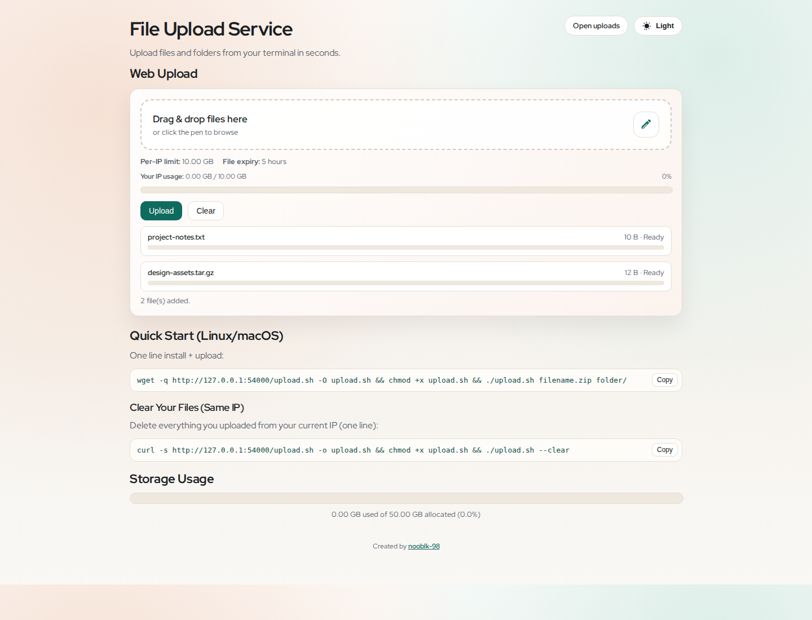
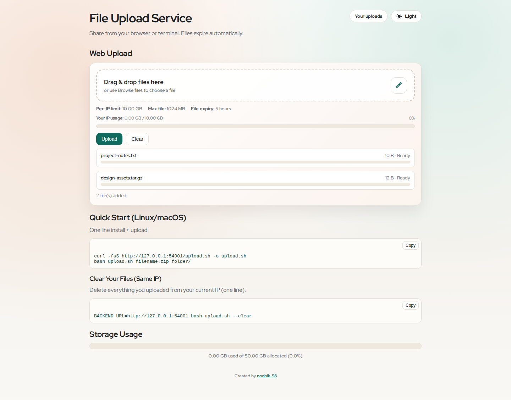
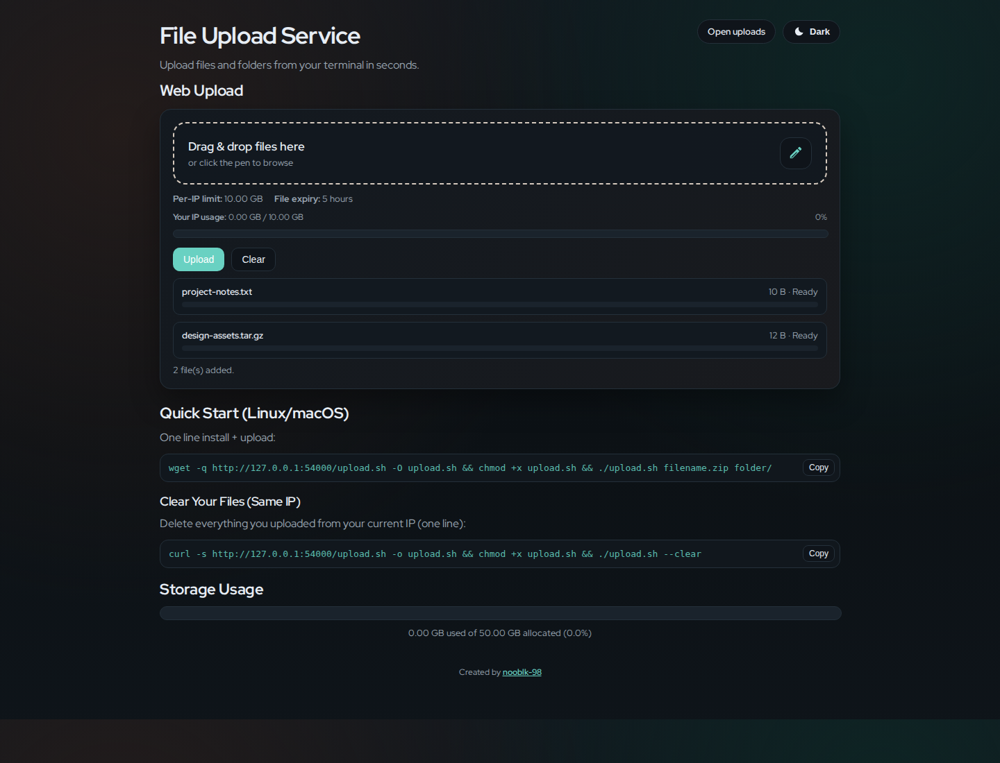
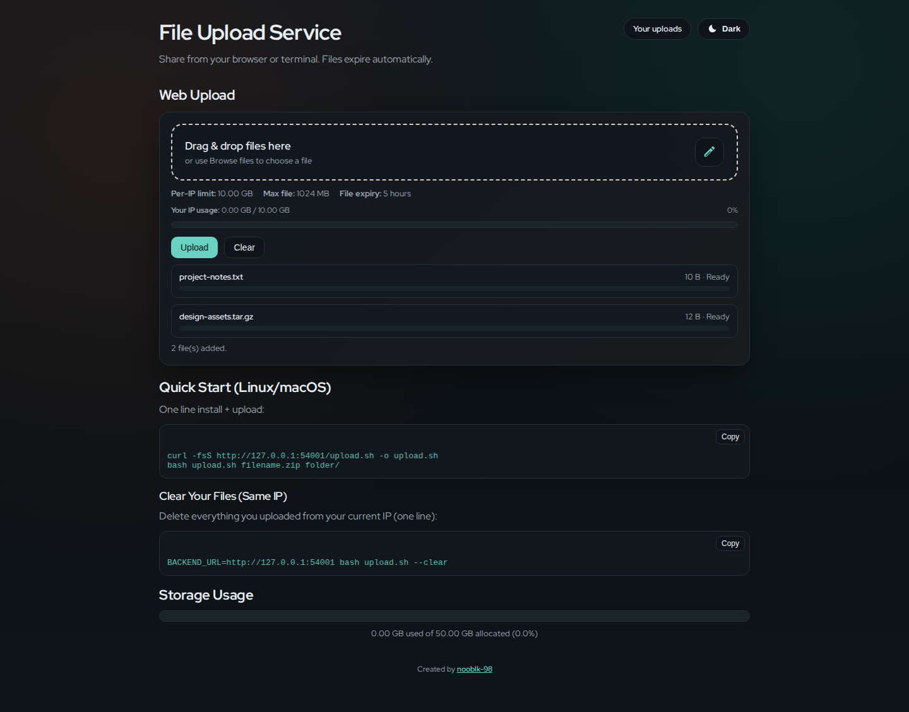
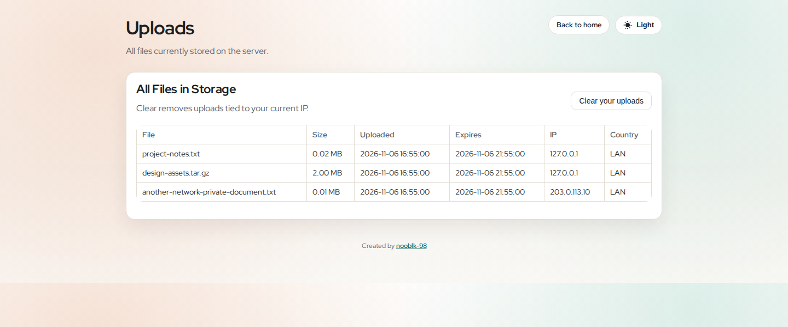
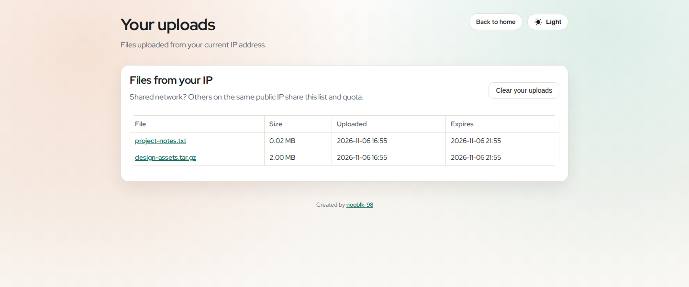
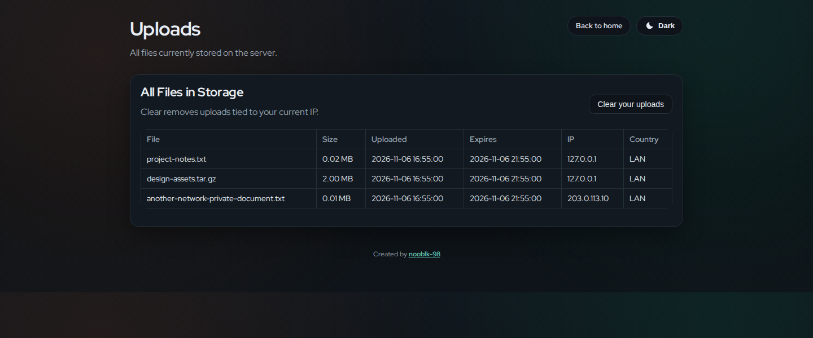
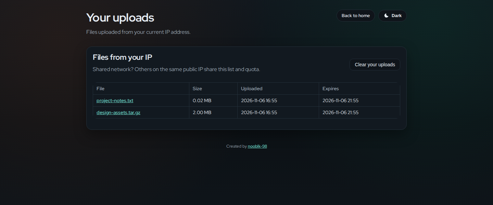
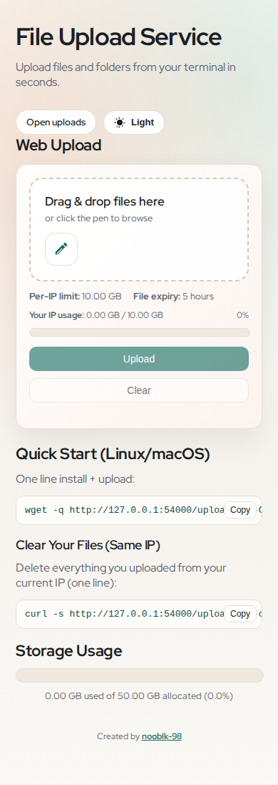
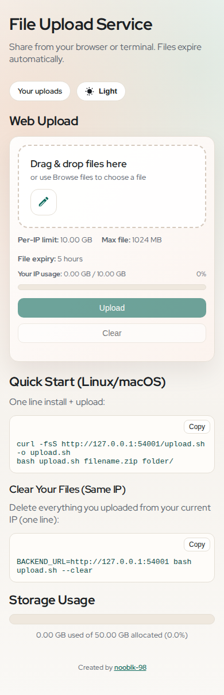

# UI review and screenshot provenance

These are real Chromium screenshots, captured with Playwright's `page.screenshot()` from local application servers. No screenshot is a mockup. The live service was not modified and no production uploads were used.

## Baseline and fixtures

- **Before:** repository commit `ba0470100f5bd81fb8a25cc4dee8174d2e5168bb`, served from a separate detached worktree.
- **After:** the `fix/security-docs-refresh` branch containing this document.
- **Capture date:** 2026-11-06, Asia/Colombo.
- **Viewports:** home 1440 × 1100; uploads 1440 × 600; mobile home 390 × 1000. Full-page captures may extend beyond the viewport.
- **Themes:** explicitly selected in localStorage, with matching browser color scheme. Fonts settled via `document.fonts.ready`; screenshot animations disabled.
- **Same synthetic store:** `project-notes.txt` (24 KiB) and `design-assets.tar.gz` (2 MiB) owned by loopback; `another-network-private-document.txt` (8 KiB) owned by documentation-only IP `203.0.113.10`. A single shared timestamp was used when seeding both stores. File bytes are synthetic.
- **Home queue:** the same two small, synthetic selected files are shown ready to upload in desktop captures; mobile captures show the empty selection state.
- **Local origins:** baseline `http://127.0.0.1:54000`; changed service `http://127.0.0.1:54001`. These appear in generated CLI snippets; the distinct ports are necessary to run both versions side by side. They are not production URLs.

The baseline uploads page publishes all three records plus IP/country fields. The changed uploads page intentionally shows only the loopback visitor's two records, without public IP/country columns.

## Before / after

| View | Before | After |
| --- | --- | --- |
| Home · light |  |  |
| Home · dark |  |  |
| Uploads · light |  |  |
| Uploads · dark |  |  |
| Mobile · light |  |  |

## Verification

`tests/browser/ui.spec.js` checks:

- Real multi-file uploads through the cooldown, exact downloaded contents, IP-scoped listing, and immediate clear-list refresh.
- An HTTP 413 leaves a visible failed state rather than reporting completion.
- Oversized selection, keyboard-operated theme switching, and persisted theme choice.
- Both pages at 320, 390, 768, 1024, and 1440 px, light/dark, with empty and long-filename populated states: **40 page/viewport/theme/state combinations**. Page/body/card overflow must stay within 1 px; tables scroll inside their own wrapper. No uncaught page errors are allowed.

## Reproduce captures

1. Run `git worktree add --detach /tmp/temp-file-share-baseline ba0470100f5bd81fb8a25cc4dee8174d2e5168bb`.
2. Create separate disposable upload/data directories for each server. Seed matching JSON records using the unchanged `filename`, `size`, `time` schema and create matching synthetic files. Use a current shared timestamp so fixtures do not expire during capture.
3. Start the baseline on port 54000 with Python 3.11/3.12, `GEO_IP_ENABLED=false`, absolute `UPLOAD_DIR`/`FILES_DB`, and `PUBLIC_BASE_URL=http://127.0.0.1:54000`.
4. Start the changed code with installed requirements, `PORT=54001`, its own absolute storage paths, and `PUBLIC_BASE_URL=http://127.0.0.1:54001`.
5. Run `npm ci --prefix tests/browser`, `npx --prefix tests/browser playwright install chromium`, then `node tests/browser/capture-screenshots.js`. `BASELINE_URL`/`CURRENT_URL` can override local origins.

The native SVG repository banner is a separate illustration, not a UI screenshot.
